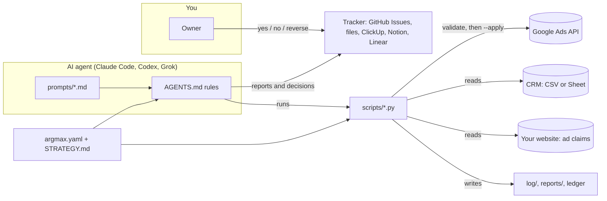

# argmax

> **Set up in one message.** Paste this into Claude Code, Codex or Grok:
>
> ```
> Set up argmax for me from https://github.com/edward-ch-hu/argmax. Follow its BOOTSTRAP.md.
> ```
>
> Your agent makes your own private copy, clones it, and walks you through onboarding.

**An AI agent that runs your Google Ads account inside hard guardrails.**

Your ad account has one job: find the spend that maximises real deals. argmax is that search, run every day.
It keeps moving bids, budgets and keywords toward the argument that wins (the topics, terms and campaigns that
close deals in your CRM, not the ones that rack up clicks), inside step sizes and caps you set, with a ledger of
every move and an approval inbox for anything bigger. You stop opening Google Ads; you read one weekly report and
answer a few "yes / no" decisions.

```
spend* = argmax_{spend in guardrails} E[deals | spend]
```

The guardrails are the constraint set: the optimiser is an LLM, the constraints are plain Python that refuses, and
no argument at run time moves them. They are kept out of the agent's reach by the run environment: the config is
locked in an environment variable the agent cannot edit, and headless runs may only call argmax's scripts and edit
its data folders (SETUP.md, "Guardrails lock").

You run argmax from your own **private** copy of this public repo (a clone pushed to a new private repo, never a
fork), because its logs and reports hold your account's data and its decisions are approvals.

## What it does

- **Daily scout** checks the account for drift (auto-apply sneaking back on, Display leaking into Search, budget
  over cap), records the day, steps winning-topic bids toward a visibility sweet spot (and experiment groups by
  their own rules), and blocks junk search terms.
- **Weekly review** reads the week, writes 3 to 5 numbered observations, reviews keywords and match types, moves
  bids and budgets toward the topics that close deals, runs ad copy A/B tests, and files a report.
- **Monthly review** recomputes the whole history from scratch (spend, new customers, first-month ROI, funnel per
  topic), audits whether last month's changes worked, writes a client-ready update, and proposes strategy changes.
- **Real deals, not vanity conversions.** It reads your CRM (CSV or Google Sheet) and judges topics on a rolling
  90-day table of spend vs leads vs wins. Noisy conversions are shown and never trusted. Optional ref codes tie a
  CRM lead back to the exact ad click.

## Guardrails (the actual product)

The agent is clever; the guardrails are dumb, deterministic Python. A script that refuses cannot be talked round;
the lock and the allowlist below make sure the agent cannot edit the script or the limits instead.

| Guardrail | Where | What happens on a breach |
|---|---|---|
| Validate by default | every write script | nothing changes without `--apply` |
| Total daily budget cap | `apply_changes.py`, `daily_guard.py` | the whole change file is refused (FAIL, exit 1) |
| Weekly bid change limit (from Monday's bid) | `apply_changes.py` | refused |
| Bid floor and ceiling | `apply_changes.py`, `daily_bids.py` | refused / clamped |
| Daily stepping window (winning groups only) | `daily_bids.py` | hand edits refused while stepping |
| Experiments: own step and weekly limits, ceiling, end date, kill rule | `daily_bids.py`, `experiments.py`, `apply_changes.py` | hand bids refused; ended and reverted by rule |
| Market price ceilings never above `market_price.safety_limit` | `market_price.py` | clamped |
| Budget reserve for an experiment's campaign | `apply_changes.py`, `daily_guard.py` | refused / ALERT |
| Max junk negatives per day, never winning-topic terms | `daily_negatives.py` | held for the weekly |
| Protection window: a term with a lead signal in the last 30 days is never blocked by spend or clicks | `keyword_review.py`, `daily_negatives.py` | skipped with the reason |
| Ad copy only from a claims library quoted from your site | `claims_check.py`, `ad_test.py` | test refused or paused |
| A/B decisions by two-proportion z-test, never the last ad | `ad_test.py` | waits for evidence |
| Evidence floors before defunding a topic | `STRATEGY.md` | spend-side fixes only |
| Change ledger with judge-by dates | `reports/changes.jsonl` | the monthly audits every change |
| Approval inbox: "Needs yes", "Unless you say no", "Done, reply reverse to undo" | your tracker | silence has a defined meaning |
| Privacy: no CRM names or emails anywhere, only fingerprints | `crm.py`, `check_external.py` | client update refused |

Everything numeric lives in the config. Lock it by putting it in `ARGMAX_CONFIG_YAML` in the run environment:
then `argmax.yaml` in the repo is an advisory copy, and only you can change a limit. Headless runs are allowed
`uv run scripts/*` and edits to `log/`, `reports/`, `decisions/` and `STRATEGY.md`, not `scripts/` or
`argmax.yaml`, and `doctor.py` and every weekly report show when `argmax.yaml` and `scripts/` last changed and by
whom. The rules also tell the agent never to change limits without your "yes"; the lock is what enforces it.

## Experiments

Sometimes the question is not "which way" but "how far": a winning ad group loses most of its impressions to ad rank
at its bid ceiling, and nobody knows where extra bid stops buying clicks. An experiment answers that inside the
guardrails. It is an entry under `experiments:` in the config (`argmax.example.yaml` has a commented one), added by
you after a "Needs yes" decision, never by a routine:

- **Type `ceiling_test`**: from its start to its end date `daily_bids.py` steps the group by the experiment's own
  rules (e.g. 20% a day, +/-60% a week), raising it while it loses over `stop_rank_lost` to rank and never lowering
  it for being visible, up to its ceiling: a fixed amount, or the **market price** (Google's first-position CPC
  estimate for its keywords, weighted by impressions), never above `market_price.safety_limit`.
- **Hands off**: while an experiment holds a group, `apply_changes.py` refuses hand bids on it. Every step is a
  ledger line with the experiment's id.
- **Budget reserve** (optional): when you raise the cap for a test, the room above the old cap belongs to the
  experiment's campaign until the end date; the other campaigns together stay under the old cap minus its pre-test
  budget (`apply_changes.py` refuses, `daily_guard.py` alerts).
- **Mid-test check**: each weekly, `experiments.py evaluate` prints bid levels against clicks, CPC and leads. When
  the last bid level bought almost no extra clicks (under 15% more) at a much higher CPC (over 30%), the test ends
  early and the bid goes back to the knee.
- **Kill rule**, judged on the end date: no new leads (or a cost per lead over your limit) reverts the bid and the
  budget to their pre-test values; otherwise the test passed and the weekly owns the bid, with the same ceiling.
- Ending by the mid-test check or the kill rule is applied, then reported as "Done, reply reverse to undo"
  (`experiments.py reverse <id>`). Starting, extending or ending one early by hand needs your "yes".

## Architecture



## The three routines

| Routine | When | Changes the account? | Prompt |
|---|---|---|---|
| Daily scout | Tue to Sun, morning | bid steps on winning and experiment groups, junk negatives | `prompts/daily-scout.md` |
| Weekly review | Monday, morning | yes, inside Autonomy and the limits | `prompts/weekly-review.md` |
| Monthly review | the 1st | never | `prompts/monthly-review.md` |

## Quickstart (about 15 minutes of your time; no developer token, no manager account)

1. **Make your private copy.** Paste the one-message prompt at the top into your agent, or by hand:
   `git clone https://github.com/edward-ch-hu/argmax my-argmax && cd my-argmax && git remote rename origin upstream
   && gh repo create my-argmax --private --source . --remote origin --push` (details in `BOOTSTRAP.md`).
2. **Open it in your agent and say "onboard me".** `prompts/onboarding.md` walks you through prerequisites, the
   Google Ads API, picking the account, your business profile (goal, KPI, markets, report language, deal currency),
   your tracker, your CRM, your strategy, the guardrails, a first read-only run, and scheduling. Google Ads API
   access is a Google Cloud project with the API enabled, a Desktop OAuth client, and Explorer access (applied for
   on the project's Google Ads API Overview page, usually approved automatically). It saves progress, so "continue
   onboarding" resumes.
3. **Read your first weekly report**, answer decisions with "yes", "no" or "reverse".

Prefer doing it by hand? `SETUP.md` is the full manual reference. `uv run scripts/doctor.py` tells you what is
still missing at any point.

## Pick your agent

| | Claude Code | Codex CLI | Grok Build |
|---|---|---|---|
| Rules file | `CLAUDE.md` (imports `AGENTS.md`) | `AGENTS.md` | `AGENTS.md` (also reads `CLAUDE.md`) |
| Headless | `claude -p` | `codex exec` | `grok -p` |
| Scheduling | cloud scheduled tasks (`/schedule`), Actions, cron | Actions (`openai/codex-action`), cron | Actions (no official action), cron |
| MCP trackers | yes (claude.ai connectors in the cloud) | yes | yes |
| Guide | [docs/agents/claude-code.md](docs/agents/claude-code.md) | [docs/agents/codex.md](docs/agents/codex.md) | [docs/agents/grok.md](docs/agents/grok.md) |

`github-issues` (via `gh`) and `files` trackers work with every agent, headless, no MCP needed.

## Pick your strategy

The business profile (`business:` in `argmax.yaml`) says what you want: the goal (leads, sales, ROAS, calls or
awareness), the KPI that counts, your markets and their ad languages, and the language you read reports in.
`STRATEGY.md` is the agent's standing brief on how to get there: evidence rules, topic spend targets, phases.
Start from a template in [strategies/](strategies/README.md) that fits your goal: B2B lead gen, e-commerce ROAS,
local services, new-account discovery, brand defense. Each one asks where bidding ends up: a hand-off to Google's
Smart Bidding (high, clean conversion volume) or agent-run manual CPC for good (few real deals, noisy conversions),
recorded as `business.bidding_end_state` too. Or let `prompts/strategy-interview.md` interview you, or port
your existing notes.

## Safety notes

- **Validate by default, `--apply` to change.** Every write script prints what it would do and changes nothing
  until `--apply`. A FAIL line means nothing changed, and the agent is told never to work around one.
- **Secrets never touch the repo**: `google-ads.yaml`, `client_secret*.json` and env vars only (all gitignored).
- **Your data stays in your private copy.** The public repo gitignores every runtime path; your copy tracks
  them with `git add -f`, and `upstream` is set read-only. `doctor.py` fails, and every routine stops, when the
  copy's GitHub repo is not private.
- **Auto-apply recommendations stay off**, and the daily guard alerts if Google turns any back on.
- You are responsible for your ad account. Start with conservative limits; onboarding defaults to them.

## FAQ

**Does it need a CRM?** No. With `crm.source: none` it judges on lead-signal conversions and says so in every
report. With a CRM it judges on real deals, which is the point.

**Will it blow my budget?** Its changes cannot take the total daily budget above your cap: `apply_changes.py`
refuses the whole file. With the config locked in `ARGMAX_CONFIG_YAML` the cap itself is out of the agent's reach.
Raising the cap is a "Needs yes" decision for you.

**Can it write ads?** Only from a library of claims quoted verbatim from your own website, checked against the
live site before each test. New copy outside the library is a proposal you approve.

**Do I need a developer token or a manager account?** No. Google sunset developer tokens on September 9, 2026;
access now belongs to the Google Cloud project that owns your OAuth client, and your own Google login signs in to
the ad account. An existing token or manager account keeps working (SETUP.md, step 1).

**Which Google Ads API access level do I need?** Explorer, which Google usually approves automatically. It allows
2,880 API operations a day on live accounts; argmax uses about 40 on a normal day and under 400 on Mondays (counted
in SETUP.md, "API access levels and quota"; `doctor.py` shows it). Explorer leaves out Keyword Planner, so the
weekly keyword review skips new keyword ideas with a NOTE. Apply for Basic (brand verification first) only if you
want those ideas or hit the daily limit.

**Which agent is best?** Whichever you already pay for. The engine is plain Python; the agent reads markdown.

**How do I get updates?** "update argmax from upstream" in your agent, or `docs/updating.md`.

**Is this affiliated with Google, Anthropic, OpenAI or xAI?** No.

## Layout

```
AGENTS.md            rules for every agent (CLAUDE.md points here)
BOOTSTRAP.md         for an agent setting up a new private copy
argmax.example.yaml  every setting, commented (your argmax.yaml is gitignored)
STRATEGY.example.md  the strategy structure; strategies/ has ready-made ones
prompts/             daily, weekly, monthly routines; onboarding; strategy interview
scripts/             the engine (validate-only by default)
trackers/            how to report and ask for approval in each tool
docs/                agents, ref codes, updating, examples
tests/               pytest, no network
```

## License

MIT, see [LICENSE](LICENSE). Contributions welcome: `uv run pytest -q && uv run ruff check .` before a PR.
